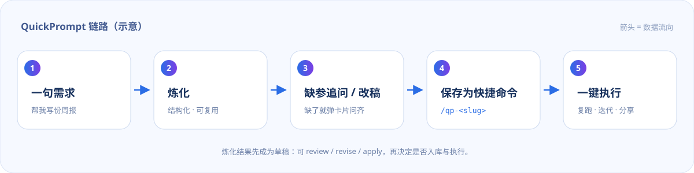

<p align="center">
  
</p>

# QuickPrompt

Forge a rough request into a structured prompt, save it as a `/qp-<slug>` command, run it again in one keystroke.

[](LICENSE)
[](#compatibility)
[](https://github.com/wyylalala/QuickPrompt)

[中文](README.md) | English

---

## Why QuickPrompt

Anyone who types long prompts has been through this:

- The same prompt gets rewritten every week, or dug out of a note and pasted back in;
- The more casually the request is phrased, the less stable the answer — you end up adding role, scope and output format by hand every time;
- The prompts you keep are scattered across chats and documents, so a new session starts from zero.

QuickPrompt folds that into one loop: **forge → save as a command → run again**. Forging makes one model call with the model your session already uses, and returns a prompt with a role, a goal, steps, constraints and an output format. Once saved it is a real slash command: missing variables are asked for before it runs.

## Features

| Capability | What it does |
| --- | --- |
| **Forge** | `/qp <rough request>` rewrites it into a structured prompt and runs it in the current session |
| **Saving is the command** | `/qp save weekly --title=Weekly` adds `/qp-weekly`; type it and go |
| **One-command run** | The rendered text is delivered to the session as a user message and wakes the agent; with `autoRun: false` it is only echoed |
| **Missing-variable card** | Required variables that were not supplied produce one question card (combined for several slots); `--no-ask` skips it |
| **Draft loop** | `--review` forges only, `/qp revise` rewrites the draft, `/qp apply` sends it; `/qp edit` rewrites a saved entry |
| **Variables** | `{{topic}}` and `{{topic:default}}`, values as `topic=Q4` or in template order |
| **Agent sharing** | A `quick_prompt` tool (list / get / save / delete / run / forge) works on the same library |
| **Local first** | One human-readable JSON file, atomic writes, corrupt files backed up, no upload, no telemetry |
| **Zero dependencies** | Plain ESM, no third-party npm package, no build step |

## Install

Requires DSH 0.2.1 or newer (slash commands come from `@deepseek-ai/dsh-commands`). Pick one source.

### 1. Local directory (recommended today)

The repository root is the plugin package root (`package.json` declares `dsh.bundle.patch`). Install it into the current profile:

```text
plugin_manager
  action: install_bundle
  target: <path to this repository>
```

Equivalent CLI:

```sh
dsh plugin --profile <profile> add <path to this repository>
```

Replace `<profile>` with the profile your host actually uses. `application: applied` in the result means it took effect.

> `plugin_manager` asks for approval (approval=ask) during install. That is expected.

### 2. From the GitHub source

```sh
dsh plugin --profile <profile> add github:wyylalala/QuickPrompt
```

Plain ESM: the source runs as-is, with no `npm install` and no build artifacts. Good for tracking the latest code or when the local checkout is not around.

### 3. npm

**Not published yet.** The package is named `dsh-quickprompt`, but it is not on npm, so entering the package name in `plugin_manager` will not install anything today. The release steps live in [docs/RELEASING.md](docs/RELEASING.md); this section will be updated once it ships.

### After installing

- Type `/qp` — you should see the help text. If not, restart the host once (bundle load timing depends on the host).
- `/qp path` prints the current library file location.
- The plugin row id is `quickprompt` and the default command prefix is `qp`; both are configurable.

## Usage

Commands below use the default prefix `qp`. If you change `commandPrefix`, replace `/qp` accordingly.

| Command | What it does |
| --- | --- |
| `/qp` | Show help |
| `/qp <request>` | Forge, then run immediately (`--dry` echoes only, `--review` forges only) |
| `/qp <request> --save=<slug>` | Forge, run, and save as `/qp-<slug>` on the way |
| `/qp forge <request>` | Forge and echo only |
| `/qp save <slug> [--title=...] [--desc=...]` | Save the most recent forge result |
| `/qp-<slug>` | Run a saved prompt (missing variables are asked for) |
| `/qp-<slug> topic="Q4 review"` | Run with arguments |
| `/qp run <slug> [key=value ...]` | Render and run a saved prompt |
| `/qp list` | List saved prompts and their variables |
| `/qp show <slug>` | Show one prompt's body and variables |
| `/qp revise <feedback>` | Rewrite the current draft (with `--review` / `apply`) |
| `/qp apply [--save=<slug>]` | Send the current draft, optionally saving it |
| `/qp edit <slug> <feedback>` | Rewrite a saved entry (`--dry` previews only) |
| `/qp rm <slug> --yes` | Delete it and remove the dynamic command |
| `/qp path` | Show the library file location |

Variable rules:

- `{{topic}}` is required; if it is missing the plugin asks with a card. When asking is unavailable (sub-agents, headless, `--no-ask`, `askMissing: false`) it falls back to an error listing the missing variables.
- `{{topic:default}}` may be omitted and then uses the default.
- `\{{` is an escape and renders a literal `{{`.
- Quote values that contain spaces (`topic="Q4 review"`); values may also be given in template order.
- With no variables in the template, extra arguments are appended to the prompt as additional context.
- More than 8 missing variables at once skips the card and reports the list, so the UI is not flooded.

### Scenario 1 — one request, forged and run

```text
/qp Turn this week's commit log into a weekly report and send it to the team
```

The forge runs, and the result is delivered into the session to execute. To look before you leap:

```text
/qp Turn this week's commits into a weekly report --review   # forge only, no send
/qp Write my weekly report --dry                             # echo only
/qp Write my weekly report --save=weekly                     # save as /qp-weekly
```

### Scenario 2 — reuse a command, missing variables get asked

```text
/qp save weekly --title=Weekly
/qp-weekly
```

`{{topic}}` was never supplied, so the plugin asks with one question card (combined for several slots) and runs as soon as it is answered. Or pass it directly:

```text
/qp-weekly topic="Q4 review"
```

`/qp-weekly --no-ask` (or `askMissing: false`) skips the card and reports the missing variables instead.

### Scenario 3 — review, revise, apply

```text
/qp Write a campaign retrospective for the ops team --review
/qp revise Lead with the conclusion, add a failure-analysis section
/qp apply --save=retro
```

`--review` and `revise` share one draft; only `apply` sends it. For an entry that is already saved:

```text
/qp edit retro Make the tone more restrained --dry   # preview, no write
/qp edit retro Make the tone more restrained         # write back; /qp-retro updates
```

Forge results are cached per session, so saving does not require copying the prompt back anywhere.

## One loop

Commands, the model-side tool, and a planned Plugins-page panel all read and write the same local library; the first two are available today:



## Configuration

Override the plugin config in the profile's `cordis.patch.yml`:

| Key | Default | Meaning |
| --- | --- | --- |
| `commandPrefix` | `qp` | Command prefix; must match `^[a-z][a-z0-9_-]*$` |
| `autoRun` | `true` | Whether `/qp-<slug>` sends immediately; `false` only echoes |
| `askMissing` | `true` | Ask with a card for missing required variables; `false` errors instead |
| `maxPromptChars` | `8000` | Character cap for one prompt (forge output is cut to this) |
| `maxPromptCommands` | `50` | How many `/qp-*` dynamic commands are registered; the rest stay reachable via `run <slug>` |
| `libraryPath` | empty | Empty = `%DSH_HOME%/quickprompt/prompts.json`; an absolute path moves it |
| `forgeSystemPrompt` | built-in | System prompt used when forging |
| `forgeModel` | unset | `{ provider, model }`; unset uses the session's model |

```yaml
- override:
    id: quickprompt
    config:
      commandPrefix: qp          # command prefix
      autoRun: true              # send immediately when running a saved command
      askMissing: true           # ask for missing variables
      maxPromptChars: 8000
      maxPromptCommands: 50
      libraryPath: ''            # empty = %DSH_HOME%/quickprompt/prompts.json
      # forgeSystemPrompt: how you want the forging model to write prompts...
      # forgeModel: { provider: <provider>, model: <model> }
```

Reload the host after changing config (restart, or the host's plugin hot-reload).

## Data and privacy

- **Where**: the default library is `%DSH_HOME%\quickprompt\prompts.json`; with `DSH_HOME` unset it falls back to `~/.dsh/quickprompt/prompts.json`. `/qp path` prints the real path.
- **Format**: one human-readable JSON file you can edit in any editor; the plugin reads it on load.
- **Writes**: atomic (temporary file plus rename). A corrupt file is renamed to `prompts.json.corrupt-<timestamp>` and kept instead of being dropped.
- **Offline**: nothing is uploaded and nothing is collected; there is no telemetry. Forging sends your request through the model channel your session already uses, exactly like a normal turn; beyond that the plugin makes no network requests.
- **Uninstall keeps the library**: removing the plugin does not delete the file; reinstalling reads it back.
- **Careful**: prompts are injected into model context — do not paste secrets into them.

## Development

```powershell
node test/render.test.js   # template parsing / rendering / argument binding / store (pure functions)
node test/plugin.test.js   # fake host: forge -> save -> dynamic command -> deliver
npm run check:leaks        # or node tools/check-leaks.mjs; scans for machine paths and local traces
```

Both test files currently hold 27 cases in total, all passing (the count grows with the feature set; trust the run output). `node --test test/` also works, but inside a sandboxed DSH session it must spawn a child process (the Windows sandbox reports `spawn EPERM`), so the scripts run the test files directly.

Layout:

```text
index.js              host side: commands, tool, forge, delivery
lib/render.js         template parsing / rendering / argument binding (pure)
lib/store.js          JSON library (atomic writes, corrupt-file backup)
lib/forge.js          forge instruction and streaming aggregation
client.js             Plugins-page panel (in development, unverified)
locale/               zh / en strings
assets/               README and panel mock-ups (SVG)
docs/                 release and listing notes
tools/check-leaks.mjs machine-path self-check
test/                 unit and integration tests
```

## Compatibility

| Host | `/qp` commands and the `quick_prompt` tool |
| --- | --- |
| DSH Desktop / `dsh web` 0.2.1+ | Yes |
| Other hosts (TUI, ACP, sub-agents, scripted calls) | Yes |
| DSH 0.2.0 and older | Not verified; upgrade to 0.2.1+ |

Commands and the tool depend on no UI capability and behave the same on every host above.

## Roadmap

- **npm release**: the package name is `dsh-quickprompt`; steps are in [docs/RELEASING.md](docs/RELEASING.md). Install-by-name lands once it ships.
- **Market listing**: submit to the awesome-dsh-plugin catalog so dshmarket can find it; also in RELEASING.md, not done yet.
- **Prompt-library panel (in development)**: view, edit, create and delete prompts on a Plugins-page tab; design mock at [assets/panel.svg](assets/panel.svg). A host loads plugin UIs only at startup, and this one has not been verified on a running host yet — usage notes land here once it is.

## Credits

Inspired by **@毕方BitFun**'s Douyin video "用这个功能，炼化Prompt，一键执行⚡ 避免手打" ("use this to forge a prompt and run it in one click — no more hand-typing"). The video shows that product's own interaction; this is a native DSH take on the same idea (commands + tool + local library), not a UI clone.

Thanks to DeepSeek Harness for the plugin, command and tool interfaces.

## License

MIT © 2026 wyylalala — see [LICENSE](LICENSE).
