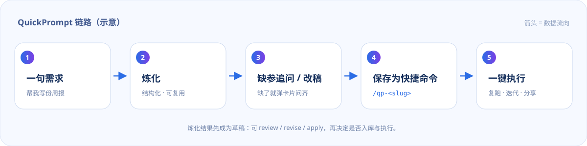

<p align="center">
  
</p>

# QuickPrompt

把一句口语需求「炼化」成结构化 Prompt，存成 `/qp-<slug>` 快捷命令，之后一键复跑。

[](LICENSE)
[](#兼容性)
[](https://github.com/wyylalala/QuickPrompt)

[English](README.en.md) | 中文

---

## 为什么用它

用手打长提示词的人，大概都经历过这三件事：

- 同一段 Prompt 反复重写，或者从笔记、聊天记录里翻出来再复制粘贴；
- 需求说得越口语，模型输出越飘——角色、边界、输出格式都得自己临时补；
- 攒下来的 Prompt 散在各处，换个会话、换台机器就找不到了。

QuickPrompt 把这条链路收成三步：**炼化 → 存成命令 → 复跑**。炼化调用一次当前会话所用的模型，产出一段带角色、目标、步骤、约束、输出格式的结构化 Prompt；存下来之后它就是一条真正的斜杠命令，变量没给会先问齐，再执行。

## 特性

| 能力 | 说明 |
| --- | --- |
| **炼化** | `/qp <一句粗糙需求>` 把它重写成结构化 Prompt，然后直接在当前会话里执行 |
| **入库即命令** | `/qp save weekly --title=周报` 保存后自动多出一条 `/qp-weekly`，输入即用 |
| **一键执行** | 渲染结果作为一条用户消息发进当前会话并唤醒 Agent；`autoRun: false` 时只回显 |
| **缺参追问** | 必填变量没给时弹一张问题卡片（多个变量合成一张），答完自动执行；`--no-ask` 跳过 |
| **改稿** | `--review` 只炼化、`/qp revise` 改一版、`/qp apply` 才发送；`/qp edit` 直接改已存条目 |
| **变量模板** | 支持 `{{主题}}` 与 `{{主题:默认值}}`，可写 `主题=Q4`，也可按模板顺序传值 |
| **Agent 共用** | 模型侧有 `quick_prompt` 工具（list / get / save / delete / run / forge），读写同一个库 |
| **本地优先** | 一个人类可读的 JSON 文件，原子写、损坏自动备份，不上传、无遥测 |
| **零依赖** | 纯 ESM，不依赖任何第三方 npm 包，也不需要构建步骤 |

## 安装

要求 DSH 0.2.1 或更新（斜杠命令由 `@deepseek-ai/dsh-commands` 提供）。三种来源，按你的情况挑一种。

### 1. 本地目录（当前推荐）

仓库根目录就是插件包根目录（`package.json` 声明了 `dsh.bundle.patch`），把它装进当前 profile：

```text
plugin_manager
  action: install_bundle
  target: <本仓库路径>
```

命令行的等价写法：

```sh
dsh plugin --profile <profile> add <本仓库路径>
```

`<profile>` 换成宿主实际使用的 profile 名。返回 `application: applied` 即生效。

> `plugin_manager` 的安装会要求审批（approval=ask），属于正常现象。

### 2. 从 GitHub 源码安装

```sh
dsh plugin --profile <profile> add github:wyylalala/QuickPrompt
```

纯 ESM，源码直接可运行，不需要 `npm install`，也没有构建产物。适合想跟最新代码、或本地目录不在手边的情况。

### 3. npm

**暂未发布。** 包名定为 `dsh-quickprompt`，但还没发到 npm，所以现在 `plugin_manager` 里填包名装不上。发布流程写在 [docs/RELEASING.md](docs/RELEASING.md)，发布后会同步更新本节。

### 装完确认

- 输入 `/qp` 应看到帮助文本；没有就重启一次宿主（bundle 的加载时机取决于宿主）。
- `/qp path` 显示当前库文件位置。
- 插件行 id 是 `quickprompt`，默认命令前缀是 `qp`，两者都可以在配置里改。

## 使用

下面的命令都按默认前缀 `qp` 写；改了 `commandPrefix` 就把 `/qp` 换成 `/你的前缀`。

| 命令 | 作用 |
| --- | --- |
| `/qp` | 查看帮助 |
| `/qp <一句需求>` | 炼化后立即执行（`--dry` 只看回显，`--review` 只炼化） |
| `/qp <需求> --save=<slug>` | 炼化、执行，并顺手存成 `/qp-<slug>` |
| `/qp forge <需求>` | 只炼化并回显，不执行 |
| `/qp save <slug> [--title=标题] [--desc=描述]` | 保存最近一次炼化结果 |
| `/qp-<slug>` | 执行已保存的提示词（缺变量会追问） |
| `/qp-<slug> 主题="Q4 复盘"` | 带参执行 |
| `/qp run <slug> [变量=值 ...]` | 渲染并执行已保存的提示词 |
| `/qp list` | 列出已保存的提示词与变量 |
| `/qp show <slug>` | 查看某条的原文与变量 |
| `/qp revise <修改意见>` | 基于当前草稿改一版（配合 `--review` / `apply`） |
| `/qp apply [--save=<slug>]` | 执行当前草稿，可顺手入库 |
| `/qp edit <slug> <修改意见>` | 改写已保存的条目（`--dry` 只预览） |
| `/qp rm <slug> --yes` | 删除，并移除对应动态命令 |
| `/qp path` | 显示库文件位置 |

变量规则：

- `{{主题}}` 必填，缺了会弹卡片追问；追问不可用（子代理、无界面、`--no-ask`、`askMissing: false`）时退回「列出缺哪些变量」的报错；
- `{{主题:默认值}}` 可省略，省略时用默认值；
- `\{{` 是转义，表示字面量 `{{`；
- 参数带空格要加引号（`主题="Q4 复盘"`），也可以按模板中出现的顺序直接给值；
- 模板没有变量时，多出来的参数会作为补充上下文追加到 Prompt 末尾；
- 一次缺超过 8 个变量时不弹卡片，直接报错，避免卡片刷屏。

### 场景一：一句需求，炼化后直接跑

```text
/qp 帮我把这周的提交记录整理成一份周报，发给团队
```

回车后开始炼化，结果直接进入当前会话执行。想先看再决定：

```text
/qp 帮我把这周的提交记录整理成一份周报 --review   # 只炼化，不发送
/qp 帮我写周报 --dry                              # 只回显，快速看效果
/qp 帮我写周报 --save=weekly                      # 顺手存成 /qp-weekly
```

### 场景二：命令复用，缺变量弹卡片

```text
/qp save weekly --title=周报
/qp-weekly
```

模板里的 `{{主题}}` 没给，插件会弹一张问题卡片（多个变量合成一张）一次问齐，答完立刻执行；也可以直接带参：

```text
/qp-weekly 主题="Q4 复盘"
```

`/qp-weekly --no-ask` 或配置 `askMissing: false` 则跳过追问，改为直接报错并列出缺项。

### 场景三：先看后跑，改几稿再定

```text
/qp 给运营团队写一份活动复盘 --review
/qp revise 结论前置，加一条失败原因分析
/qp apply --save=retro
```

`--review` 与 `revise` 共用同一份草稿，`apply` 才真正发送。已经存过的条目用一句话改：

```text
/qp edit retro 语气更克制一些 --dry   # 先看改后效果，不写库
/qp edit retro 语气更克制一些         # 写回库，/qp-retro 立即生效
```

炼化结果按会话暂存，「保存」时不需要再把 Prompt 复制回来。

## 一条链路

命令、模型侧工具、以及规划中的插件页面板，读写的是同一个本地库；前两者已可用：



## 配置

在 profile 的 `cordis.patch.yml` 里覆盖插件 config：

| 键 | 默认值 | 说明 |
| --- | --- | --- |
| `commandPrefix` | `qp` | 命令前缀，必须匹配 `^[a-z][a-z0-9_-]*$` |
| `autoRun` | `true` | `/qp-<slug>` 是否直接发送；`false` 时只回显渲染结果 |
| `askMissing` | `true` | 缺必填变量时是否弹卡片追问；`false` 直接报错 |
| `maxPromptChars` | `8000` | 单个 Prompt 的字符上限（炼化结果会被截断到这个长度） |
| `maxPromptCommands` | `50` | 最多注册多少条 `/qp-*` 动态命令，超出部分仍可用 `run <slug>` |
| `libraryPath` | 空 | 留空 = `%DSH_HOME%/quickprompt/prompts.json`；填绝对路径可换位置 |
| `forgeSystemPrompt` | 内置指令 | 自定义炼化用的 system prompt |
| `forgeModel` | 未设置 | `{ provider, model }`；未设置时用当前会话所用的模型 |

```yaml
- override:
    id: quickprompt
    config:
      commandPrefix: qp          # 命令前缀
      autoRun: true              # 执行已存命令时是否直接发送
      askMissing: true           # 缺参数是否弹卡片
      maxPromptChars: 8000
      maxPromptCommands: 50
      libraryPath: ''            # 留空 = %DSH_HOME%/quickprompt/prompts.json
      # forgeSystemPrompt: 你希望模型如何写提示词……
      # forgeModel: { provider: <provider>, model: <model> }
```

改完配置需要让宿主重新加载（重启，或按宿主的插件热加载方式刷新）。

## 数据与隐私

- **位置**：默认库文件是 `%DSH_HOME%\quickprompt\prompts.json`；`DSH_HOME` 未设置时回落到 `~/.dsh/quickprompt/prompts.json`。`/qp path` 可以直接看到实际路径。
- **格式**：一个人类可读的 JSON 文件，可以直接用编辑器改，重启后插件会读取它。
- **写入**：临时文件 + rename 的原子替换；文件损坏时会被重命名为 `prompts.json.corrupt-<时间戳>` 保留下来，而不是直接丢弃。
- **不联网**：插件不上传、不收集任何数据，没有遥测。炼化会把你的需求交给当前会话所用的模型通道（和正常对话一样），除此之外不发起网络请求。
- **卸载不删库**：移除插件不会删除库文件，重装后自动读回。
- **注意**：库里的 Prompt 会随会话注入到模型上下文，别把密钥之类的东西写进提示词。

## 开发

```powershell
node test/render.test.js   # 模板解析 / 渲染 / 参数绑定 / 存储的纯函数测试
node test/plugin.test.js   # 假 Host 跑通 forge → save → 动态命令 → 发送
npm run check:leaks        # 或直接 node tools/check-leaks.mjs，扫机器路径等本机痕迹
```

两个测试文件当前共 27 个用例，全部通过（数量随功能增长，以运行输出为准）。`node --test test/` 也可以，但在沙箱化的 DSH 会话里它需要 spawn 子进程（Windows 沙箱会报 `spawn EPERM`），所以脚本直接运行测试文件。

目录结构：

```text
index.js              Host 侧：命令、工具、炼化、发送
lib/render.js         模板解析 / 渲染 / 参数绑定（纯函数）
lib/store.js          JSON 库（原子写、损坏备份）
lib/forge.js          炼化指令与流式聚合
client.js             插件页面板（开发中，待验证）
locale/               zh / en 文案
assets/               README 与面板示意图（SVG）
docs/                 发布与上架说明
tools/check-leaks.mjs 机器路径自查
test/                 单元 + 集成测试
```

## 兼容性

| 宿主 | `/qp` 命令与 `quick_prompt` 工具 |
| --- | --- |
| DSH Desktop / `dsh web` 0.2.1+ | 可用 |
| 其他宿主（TUI、ACP、子代理、脚本调用） | 可用 |
| DSH 0.2.0 及更早 | 未验证，建议升级到 0.2.1+ |

命令与工具不依赖任何界面能力，在上述宿主里行为一致。

## 路线图

- **npm 发布**：包名 `dsh-quickprompt`，步骤见 [docs/RELEASING.md](docs/RELEASING.md)；发布后安装方式改成填包名。
- **市场收录**：提交到 awesome-dsh-plugin 精选目录，之后可在 dshmarket 搜到；同样写在 RELEASING.md，尚未执行。
- **提示词库面板（开发中）**：插件页内直接查看、编辑、新建、删除提示词，设计稿见 [assets/panel.svg](assets/panel.svg)。宿主只在启动时装载插件界面，该功能尚未在运行中的宿主上验证通过，验证后再补使用说明。

## 致谢

灵感来自 **@毕方BitFun** 的抖音视频「用这个功能，炼化Prompt，一键执行⚡ 避免手打」。原视频演示的是它自家产品里的交互；这里按同样的思路做了一套 DSH 原生实现（命令 + 工具 + 本地库），不是界面复刻。

也感谢 DeepSeek Harness 提供的插件、命令与工具接口。

## License

MIT © 2026 wyylalala，见 [LICENSE](LICENSE)。
